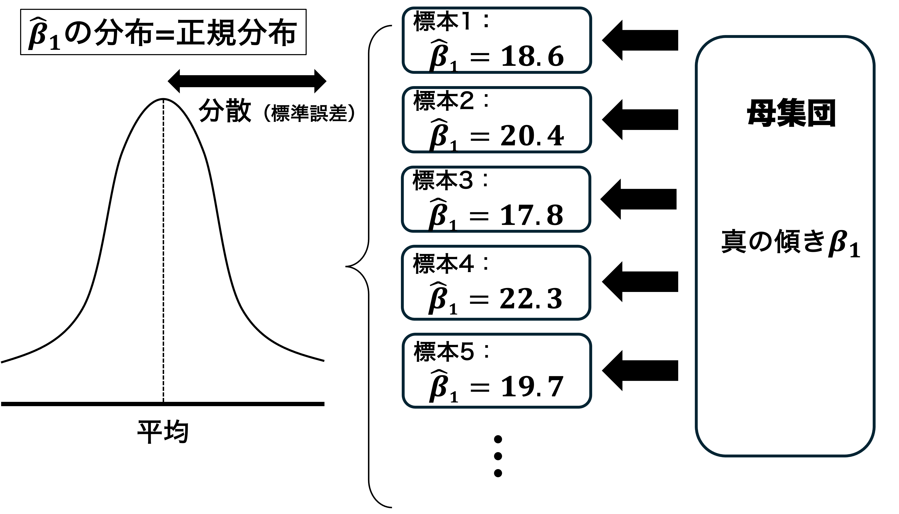



## 出席登録をお願いします


## 今日の目次

1. はじめに
1. 復習：OLSの分散と一致性
1. 適合度
1. 外れ値
1. Q&A
1. まとめ

# はじめに
## 本日の目的と到達目標 {.smaller}
#### 目的
二変量回帰モデルについてさらに深掘りする。回帰モデルがどれくらいデータを説明しているのかを示す概念である適合度について扱い、その尺度を紹介する。また外れ値とは何かについて学び、それが推定結果にどのような影響を与えるのかを議論する。

::: {.fragment .fade-in}
#### 到達目標
1. 適合度とは何かを説明できる。
1. 決定係数$R^2$の定義と性質、その限界を説明できる。
1. 外れ値がOLS推定にどのような影響を与えるのか議論できる。
1. 外れ値が分析結果に与える影響を踏まえ、外れ値を含む場合の対処方法を説明できる。

:::

## 小テストの講評
TBD

# 復習：OLSの分散と一致性
## 最小二乗法（OLS）
独立変数$X$と従属変数$Y$の間の回帰直線を考える。回帰直線の切片と傾きのOLS推定値は以下で計算。

::: {.columns}
::: {.column width=50%}
```{r}
#| fig-height: 3
#| fig-width: 3
load("data/Ch3_ChapterExample_Incumbent_vote.RData")

dta |> 
  ggplot(aes(x = RDI, y = Vote100)) +
  geom_point(size = 3) +
  geom_smooth(method = "lm", se = FALSE, colour = "red") +
  labs(x = "独立変数X", y = "従属変数Y")
```
:::

::: {.column width=50%}
- 傾き：$\hat{\beta_{1}}=\frac{\sum(X_i-\bar{X})(Y_i-\bar{Y})}{\sum(X_i-\bar{X})^2}$
- 切片：$\hat{\beta_{0}}=\bar{Y}-\hat{\beta_{1}}\bar{X}$

:::
:::

## OLSのランダム性
{.r-stretch}

## 傾きの分布の性質
::: {.fragment .fade-in}
内生性がない場合、$\hat{\beta_{1}}$の分布の平均は母集団における真の傾き$\beta_{1}$になる（**不偏性**）

:::

::: {.fragment .fade-in}
一定の条件を満たした場合、分散は$\text{var}(\hat{\beta_{1}})=\frac{\hat{\sigma}^2}{N\times\text{var}(X)}$で計算できる

::: {.incremental}
- 満たさないのは**不均一分散**や**誤差同士の相関**（クラスター化されたデータや時系列データ）の場合→別の計算式が必要
:::

:::

::: {.fragment .fade-in}
$N$が大きくなるほど分散は0に近づく→OLS推定値$\hat{\beta_{1}}$は確率的に$\beta_{1}$に収束（**一致性**）
:::


# 適合度
## 適合度 (goodness of fit)
モデルがデータにどれだけ適合しているかの度合い

::: {.fragment .fade-in}
Q. 以下のデータ（a)と（b）ではどちらがデータに適合している？（[WebClassアンケート](https://webclass.komazawa-u.ac.jp/webclass/login.php?id=55782cfa4c4320364f8bf4a3d03b59c6&page=1)）
```{r}
#| layout-ncol: 2
#| fig-height: 4
#| fig-width: 4

N <- 100
x <- runif(N, min = 4, max = 14)
x_centered <- x - mean(x) # 中心化

# --- 回帰式が「完全に一致」するデータを生成する関数 ---
make_exact_lm_data <- function(x, slope = 3, intercept = 0, sd = 1) {
  # 誤差の初期値
  e <- rnorm(length(x), mean = 0, sd = sd)
  # Xと直交する残差ベクトルを作成（傾きを理論値に固定するため）
  e_perp <- e - (sum(e * x_centered) / sum(x_centered^2)) * x_centered
  e_final <- e_perp - mean(e_perp) # 切片を理論値に固定するため
  
  # Yの生成
  y <- intercept + slope * x + e_final
  return(tibble(x = x, y = y))
}

scatter_regvar1 <- make_exact_lm_data(x, sd = 1.5)
scatter_regvar2 <- make_exact_lm_data(x, sd = 6)

y_min <- min(scatter_regvar1$y) - 2
y_max <- max(scatter_regvar2$y) + 2

scatter_regvar1 |> 
  ggplot(aes(x = x, y = y)) +
  geom_point() +
  geom_smooth(method = "lm", se = FALSE) +
  xlim(4, 14) + ylim(y_min, y_max) +
  labs(title = "データ（a）",
       x = "独立変数（X）",
       y = "従属変数（Y）")

scatter_regvar2 |> 
  ggplot(aes(x = x, y = y)) +
  geom_point() +
  geom_smooth(method = "lm", se = FALSE) +
  xlim(4, 14) + ylim(y_min, y_max) +
  labs(title = "データ（b）",
       x = "独立変数（X）",
       y = "従属変数（Y）")
```

:::

::: {.notes}
適合度が高いというのは、$X$の値がわかれば$Y$の値を正確に予測できるという意味
:::

## 決定係数$R^2$
適合度の尺度の1つで、**予測値と実際の値の相関係数を二乗したもの**

::: {.incremental}
- 0-1の値を取り、1に近ければ適合度は高く、0に近ければ適合度は低い
- 高い$R^2$は予測値と実際の値が近いことを意味
- しかし、それ以上でもそれ以下でもない
   - 内生性のあるモデルでも高い$R^2$は出ることがある
   - どれくらいの$R^2$の値なら十分かという基準もない

:::

::: {.fragment .fade-in}
→実際には$R^2$はあまり気にしないことが多い
:::

## 例：身長と賃金
```{r}
load("~/Documents/ICPA2-2026-Komazawa/data/Ch3_ChapterExample_HeightAndWages.Rdata")

dta <- dta |> 
  filter(male == 1, white == 1)
```


```{r}
dta |> 
  ggplot(aes(x = height85, y = wage96)) +
  geom_point(position = "jitter") +
  geom_smooth(method = "lm", se = FALSE, colour = "red") +
  labs(x = "身長（インチ）",
       y = "1時間あたり賃金（ドル）")
```

::: {.fragment .fade-in}
分析結果は$賃金_{i}=-13.093+0.412身長_{i}$で、$R^2=0.009$

:::

::: {.notes}
散布図と$R^2$をみて分かる通り、適合度はかなり小さい。しかしより注意すべきは傾きの推定値$0.412$。内生性がなければ（誤差項と身長に相関がなければ）、身長1インチが伸びるごとに$0.412$ドル時給が上がるという推定は正確である。しかし内生性がある場合には、この推定は正確ではない。

:::


# 外れ値
## 外れ値 (outlier)
```{r}
crime <- read.table("data/Ch2_ChapterExample_StateCrime.txt", header = T)

crime <- crime |> 
  filter(Year == 2009)
```


他のサンプルの値とは極端に異なる観測値

::: {.fragment .fade-in}
外れ値はOLSの推定結果を歪めることがあるので、取り扱いに注意

:::

## 例：都市化率と暴力犯罪

::: {.fragment .fade-in}
```{r}
crime |> 
  ggplot(aes(x = PctUrban, y = ViolentCrimerate)) +
  geom_text(aes(label = StAbbrev))  +
  labs(x = "都市化率",
       y = "暴力犯罪率（10万人あたり）")
```

:::

::: {.fragment .fade-in}
Q. 右上のワシントンDCのデータを除いた時の回帰直線の傾きは、入れた時の傾きと比べてどうなるでしょうか。（[WebClassアンケート](https://webclass.komazawa-u.ac.jp/webclass/login.php?id=d64c70dbaaec3a538db86b91e1ef5a2e&page=1)）
:::

## 外れ値の対処法
::: {.incremental}
- 散布図を用いて外れ値の有無を確認する
- 外れ値の有無で結果が変わる場合は、正直に報告する
- 外れ値を含む推定結果と含まない推定結果を両方出す
- 含める理由、あるいは含めない理由をきちんと述べる

:::

## 例：暴力犯罪率と都市化率
::: {.columns}
::: {.column width=50%}
```{r}
#| fig-height: 4
#| fig-width: 4
crime |> 
  ggplot(aes(x = PctUrban, y = ViolentCrimerate)) +
  geom_text(aes(label = StAbbrev))  +
  geom_smooth(method = "lm",
              se = FALSE,
              colour = "red") +
  geom_smooth(method = "lm",
              se = FALSE,
              colour = "blue",
              data = subset(crime, StAbbrev != "DC")) +
  labs(x = "都市化率",
       y = "暴力犯罪率（10万人あたり）")
```

:::

::: {.column width=50%}
::: {.incremental}
- DCを入れた場合（赤）→傾きは$5.61$
- DCを除いた場合（青）→傾きは$3.58$
- DCは州ではないので、除いたほうがいいかもしれない
:::
:::

:::


# Q&A
## 質問を募集します
これまでの授業の内容でわからないこと、聞いておきたいことは何かありますか。あれば[チャット](https://webclass.komazawa-u.ac.jp/webclass/login.php?id=794e2647280c975dea1763c0b5079ed5)に書き込んでください。

{.r-stretch}

# まとめ
## 本日の目的と到達目標 {.smaller}
#### 目的
二変量回帰モデルについてさらに深掘りする。回帰モデルがどれくらいデータを説明しているのかを示す概念である適合度について扱い、その尺度を紹介する。また外れ値とは何かについて学び、それが推定結果にどのような影響を与えるのかを議論する。

::: {.fragment .fade-in}
#### 到達目標
1. 適合度とは何かを説明できる。
1. 決定係数$R^2$の定義と性質、その限界を説明できる。
1. 外れ値がOLS推定にどのような影響を与えるのか議論できる。
1. 外れ値が分析結果に与える影響を踏まえ、外れ値を含む場合の対処方法を説明できる。

:::

## 次回までに
::: {.fragment .fade-in}
#### 事後学習

 - 授業資料を見直し、目標到達をセルフチェック
 - WebClass上での確認小テスト（金曜日まで）

:::

::: {.fragment .fade-in}
#### 事前学習

 - 教科書（第3章全て）を再読する
 
:::

::: {.fragment .fade-in}
来週はオンラインの実習回です。PCから参加してください。
:::