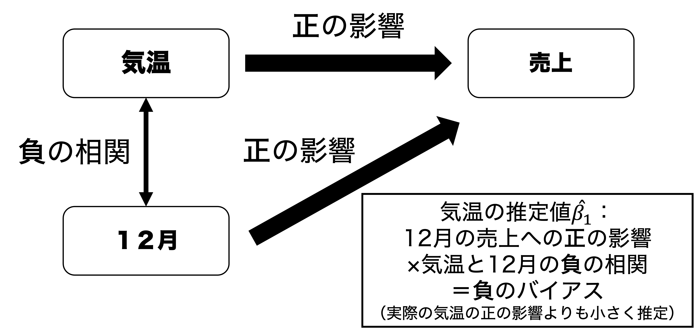



## 出席登録をお願いします


## 今日の目次

1. はじめに
1. 二変量から多変量へ
1. 多変量回帰分析
1. 欠落変数バイアス
1. 測定誤差
1. まとめ

# はじめに
::: {.notes}
目標15分
:::
## 本日の目的と到達目標
#### 目的
回帰分析のスタンダードである多変量モデルを紹介する。二変量モデルについて復習した後、多変量モデルが内生性の問題にどのように対処するのかを議論する。統制すべき変数を統制しない時に発生する欠落変数バイアスや、独立変数に測定誤差が含まれる場合の問題も合わせて検討する。

::: {.fragment .fade-in}
#### 到達目標
1. 多変量回帰モデル（$Y_i=\beta_0+\beta_{1}X_{i}+\cdots+\beta_{k}X_{i}+\varepsilon_i$）の係数の意味を説明できる。
1. 多変量モデルが欠落変数バイアスにどのように対処できるのかを説明できる。
1. 欠落変数バイアスが生じる2つの条件を列挙できる。
1. 従属変数および独立変数における測定誤差の存在が係数の推定値に与える影響を説明できる。

:::

## 本日の授業の位置付け
{.r-stretch}

## 小テストの講評
TBD

<!-- - 受験者数158人 -->
<!-- - 平均7.86/10点 -->
<!-- - 標準偏差2.4点 -->
<!-- - 最小値0点 -->
<!-- - 最大値10点 -->

<!-- よくできました。注意すべきは問6・問7（→[正答](08_testbasics_quiz.qmd)） -->

# 二変量から多変量へ

```{r}
#| echo: false
Sales <- read_dta("data/Ch3_ChapterExample_RetailSales.dta")

Sales <- Sales |> 
  mutate(RetailBillions = retail_ns / 1000)
```


## 例：気温と売上高
二変量モデル：$売上高_{i}=\beta_{0}+\beta_{1}気温_{t}+\varepsilon_{t}$

::: {.fragment .fade-in}
```{r}
Sales |> 
  ggplot(aes(x = temperature, y = RetailBillions)) +
  geom_point() +
  geom_smooth(method = "lm",
              se = FALSE) +
  labs(title = "ニュージャージー州における月ごとの売上高と気温（1992-2013）",
       x = "月の気温（華氏）",
       y = "月の小売売上高（＄10億）")
```

:::

## 分析結果とその問題
```{r}
#| include: false

Sales_result_bivar <- lm(RetailBillions ~ temperature,
                   data = Sales)

Sales_result_bivar |> summary()
```


分析結果：気温が上がるほど売上は下がる

::: {.incremental}
- $\hat{\beta}_{1}=-0.019$で標準誤差$0.007$
- $t値$は$-2.6$で5%有意

:::

::: {.fragment .fade-in}
しかし、内生性の問題

::: {.incremental}
- 誤差項の中に「12月とそれ以外」という変数
- 従属変数への影響：12月はクリスマス商戦で売上を上げる
- 独立変数との相関：12月は気温が低い

:::
:::

## 12月の影響を「差し引く」
::: {.r-stack}
::: {.fragment}
```{r}
Sales |> 
  mutate(month12 = factor(month12,
                          labels = c("他の月", "12月"))) |>  
  ggplot(aes(x = temperature,
             y = RetailBillions,
             colour = month12,
             shape  = month12)) +
  geom_point() +
  ylim(c(2.5, 12.5)) +
  labs(title = "ニュージャージー州における月ごとの売上高と気温（1992-2013）",
       x = "月の気温（華氏）",
       y = "月の小売売上高（＄10億）",
       colour = "12月",
       shape  = "12月")
```
:::

::: {.fragment}
```{r}
diff_december <- mean(Sales$RetailBillions[Sales$month12 == 1], na.rm = TRUE) - mean(Sales$RetailBillions[Sales$month12 == 0], na.rm = TRUE)

Sales |> 
  mutate(RetailBillions = ifelse(month == 12, RetailBillions - diff_december, RetailBillions),
         month12 = factor(month12,
                          labels = c("他の月", "12月"))) |>  
  ggplot(aes(x = temperature,
             y = RetailBillions,
             colour = month12,
             shape  = month12)) +
  geom_point() +
  ylim(c(2.5, 12.5)) +
  labs(title = "ニュージャージー州における月ごとの売上高と気温（1992-2013）",
       x = "月の気温（華氏）",
       y = "月の小売売上高（＄10億）",
       colour = "12月",
       shape  = "12月")
```
:::

:::

## 分析結果
```{r}
Sales_result_bivar <- lm(RetailBillions ~ temperature,
                   data = Sales)
Sales_result_multi <- lm(RetailBillions ~ temperature + month12,
                   data = Sales)

modelsummary(
  list("二変量" = Sales_result_bivar,
       "多変量" = Sales_result_multi),
  output = "kableExtra",
  coef_rename = c("temperature" = "気温",
                  "month12"     = "12月",
                  "(Intercept)" = "定数項"),
  statistic = c("({std.error})", "[{statistic}]"),
  stars = TRUE,
  gof_map = list(
    list("raw" = "nobs", "clean" = "N", "fmt" = 0),
        list("raw" = "rmse", "clean" = "回帰標準偏差", "fmt" = 3),
    list("raw" = "r.squared", "clean" = "R2", "fmt" = 3)
  ),
  ) |> 
  kable_styling(full_width = FALSE,
                bootstrap_options = c("striped", "hover"),
                font_size = 30)


```


# 多変量回帰分析
## 多変量回帰分析（重回帰分析）
#### multiple regression
$k$個の独立変数を含む以下の多変量モデルを推定

$$
Y_i=\beta_0+\underbrace{\beta_{1}X_{i1}+\beta_{2}X_{2i}+\cdots+\beta_{k}X_{ki}}_{k\text{個の独立変数}}+\varepsilon_i
$$

::: {.incremental}
- $j$番目の係数$\beta_{j}$：**他の変数の値を固定した上で、**$X_{i}$が1単位増えると$Y_{i}$がどれくらい増えるか
   - 「他の条件が等しければ（*ceteris paribus*）」
- 関心のある独立変数以外の別の変数を**統制変数**という
   - 統制変数を投入することで、その変数を誤差項から引き出し内生性に対処できる

:::

## 推定プロセス
推定プロセスは二変量と基本的には同じ

::: {.incremental}
- 残差平方和：$\sum \hat{\varepsilon_{i}}^2=\sum (\underbrace{Y_{i} - \hat{Y}_{i}}_{残差})^2=\sum \{Y_{i}-(\hat{\beta_{0}}+\hat{\beta_{1}}X_{1i}+\hat{\beta_{2}}X_{2i}+\cdots+\hat{\beta_{k}}X_{ki})\}^2$
- 残差平方和を最小化する$\hat{\beta}_{0}, \hat{\beta}_{1}, \cdots, \hat{\beta}_{k}$を求める
   - 数学的に求めようとすると微積分＋線形代数が必要
   - 実際にはRがやってくれる

:::

## 例：身長と賃金 {.scrollable}
身長と賃金の関係の分析→何が読み取れる？（[WebClassチャット](https://webclass.komazawa-u.ac.jp/webclass/login.php?id=0dba425ee2848c03be42bb29355450d9)）
```{r}
load("data/Ch3_ChapterExample_HeightAndWages.Rdata")

height <- dta
rm(dta)

height_bivar <- lm(wage96 ~ height85,
                   data = height)
height_multi_a <- lm(wage96 ~ height85 + height81,
                     data = height)
height_multi_b <- lm(wage96 ~ height85 + height81 + athlets + clubnum,
                     data = height)

modelsummary(
  list("二変量" = height_bivar,
       "多変量(a)" = height_multi_a,
       "多変量(b)" = height_multi_b),
  output = "kableExtra",
  coef_rename = c("height85" = "成人身長",
                  "height81" = "青年期の身長",
                  "athlets"  = "運動部所属",
                  "clubnum"  = "クラブ所属数",
                  "(Intercept)" = "定数項"),
  statistic = c("({std.error})", "[{statistic}]"),
  stars = TRUE,
  gof_map = list(
    list("raw" = "nobs", "clean" = "N", "fmt" = 0),
        list("raw" = "rmse", "clean" = "回帰標準偏差", "fmt" = 3),
    list("raw" = "r.squared", "clean" = "R2", "fmt" = 3)
  ),
  ) |> 
  kable_styling(full_width = FALSE,
                bootstrap_options = c("striped", "hover"),
                font_size = 30)


```

::: {.notes}
例：身長と賃金

- 二変量モデル：$賃金_{i}=\beta_{0}+\beta_{1}成人身長_{i}+\varepsilon_{i}$
- 分析結果からは成人時身長が高いほど賃金も高い
  - しかし、青年期の身長も関係するのでは？
    - 青年期の高身長→多くの活動→高賃金
    - 青年期の高身長→成人期の高身長
- 多変量モデル(a)：$賃金_{i}=\beta_{0}+\beta_{1}成人身長_{i}+\beta_{2}青年期の身長_{i}+\varepsilon_{i}$
  - 成人身長の影響が消えた！
  - とはいえ、活動の影響は？
    - 青年期の高身長↔多くの活動
    - 多くの活動→高賃金
- 多変量モデル(b)：$賃金_{i}=\beta_{0}+\beta_{1}成人身長_{i}+\beta_{2}青年期の身長_{i}+\beta_{3}運動部所属_{i}+\beta_{4}クラブ所属数_{i}+\varepsilon_{i}$
  - 今度は青年期の身長の影響が消えた！
:::

# 欠落変数バイアス
## 欠落変数バイアス
#### omitted variable bias
従属変数に影響し、独立変数と相関している変数をモデルに含めないと関心のある独立変数の推定値が歪む

::: {.incremental}
- 以下2つの条件が満たされるとき、欠落変数バイアスが発生
   - 欠落変数が従属変数に確かに影響する
   - 欠落変数と独立変数の間に相関がある
- 独立変数が持つ真の影響$\beta_{1}$は欠落変数がもつ影響$\beta_{2}$と独立変数と欠落変数の相関$\delta_{1}$をかけたものだけ歪む

:::

## 例：気温と売上
{.r-stretch}

## クイズ
洋画の視聴時間とTOEICの点数の例を考えます。洋画の視聴時間は本当にTOEICの点数を上げますが、他の変数として海外経験が存在するとします。

1. 海外経験はTOEICの点数に正負どちらの効果を与えるでしょうか。
1. 海外経験は洋画の視聴時間と正負どちらの相関にあるでしょうか。
1. 海外経験を含めずにモデルを分析した場合、推定される洋画視聴時間の係数は真の係数と比べて大きくなるでしょうか、それとも小さくなるでしょうか。

[WebClassで回答](https://webclass.komazawa-u.ac.jp/webclass/login.php?id=019e0bff82a200c607625d68042f1f6c&page=1)

## なぜ欠落変数バイアスが生じるのか
真のモデルは以下のように2つの独立変数（$X_{1i}$と$X_{2i}$）を持つとする。[^note1]

$$
Y_{i}=\beta_{0}+\beta_{1}X_{1i}+\beta_{2}X_{2i}+\nu_{i}
$$

::: {.fragment .fade-in}
ここで変数$X_{2i}$を欠落させたモデルを考える。

$$
Y_{i}=\beta_{0}^{omit}+\beta_{1}^{omit}X_{1i}+\epsilon_{i}
$$

:::

::: {.fragment .fade-in}
このとき係数$\beta_{1}^{omit}$の推定値がどのようになるかを考えてみよう。
:::


[^note1]: ここでは内生性はないと仮定する。すなわち$X_{1i}$と$X_{2i}$も誤差項$\nu_{i}$と相関はないとする。

---

2つの独立変数$X_{1i}$と$X_{2i}$の関係をモデル化した補助回帰分析を考えてみる。[^notes2]
$$
X_{2i}=\delta_{0}+\delta_{1}X_{1i}+\tau_{i}
$$

::: {.fragment .fade-in}
補助回帰分析を式変形の上で真のモデルに代入すると以下のように変形できる。

$$
\begin{align}
  Y_{i}&=\beta_{0}+\beta_{1}X_{1i}+\beta_{2}X_{2i}+\nu_{i}\\
       &=\beta_{0}+\beta_{1}X_{1i}+\beta_{2}(\delta_{0}+\delta_{1}X_{1i}+\tau_{i})+\nu_{i} \\
       &=(\beta_{0}+\beta_{2}\delta_{0})+(\beta_{1}+\beta_{2}\delta_{1})X_{1i}+(\beta_{2}\tau_{i}+\nu_{i})\\
       &=\beta_{0}^{omit}+\beta_{1}^{omit}X_{1i}+\epsilon_{i}
\end{align}
$$


:::


[^notes2]: ここでも内生性はない、すなわち誤差項$\tau_{i}$は$X_{1i}$と相関していないと仮定。

---

したがって、欠落モデルにおける$X_{1i}$の係数$\beta_{1}^{omit}$は以下の通りになるが、真の値からずれていることがわかる。
$$
\beta_{1}^{omit}=\underbrace{\beta_{1}}_{真の係数}+\underbrace{\beta_{2}\delta_{1}}_{バイアス}
$$

::: {.fragment .fade-in}
バイアスの構成要素は以下のとおり

::: {.incremental}
- $\beta_{2}$：真のモデルにおける$X_{2i}$の係数→従属変数$Y_{i}$に与える影響
- $\delta_{1}$：補助回帰分析における$X_{1i}$の係数→$X_{1i}$と$X_{2i}$の関係

:::

:::


# 測定誤差
## クイズ
```{r}
USPresident <- readRDS("~/Documents/ICPA2-2026-Komazawa/USPresident.RDS")

USPresident <- USPresident |> 
  mutate(RDI_error = RDI + rnorm(nrow(USPresident), 0, 1.7))

```

アメリカ大統領の分析の例を考えます。今、所得変化と与党候補の得票率のデータを集めましたが、所得変化のデータの担当者が**どうしようもないポンコツ**であり、実際の所得変化よりもだいぶばらついていることがわかりました。このとき所得変化が与党候補の得票率に与える影響の推定値（直線の傾き）は、実際のデータとポンコツデータとではどう違うでしょうか。

::: {.r-stack}
::: {.fragment}
```{r}
#| fig-height: 2

USPresident |> 
  ggplot(aes(x = RDI, y = Vote100)) +
  geom_point() +
  xlim(c(-2.5, 7.5)) +
  labs(title = "実際のデータ",
       x     = "実質賃金の変化（%）",
       y     = "与党候補の得票率")
```
:::

::: {.fragment}
```{r}
#| fig-height: 2

USPresident |> 
  ggplot(aes(x = RDI_error, y = Vote100)) +
  geom_point() +
  xlim(c(-2.5, 7.5)) +
  labs(title = "ポンコツが集めたデータ",
       x     = "実質賃金の変化（%）",
       y     = "与党候補の得票率")
```

:::

:::

## 測定誤差
#### measurement error
真の値と観測された値の間のずれ

::: {.incremental}
- 従属変数の測定誤差は大きな問題ではない
- 独立変数の測定誤差は**減衰バイアス**を起こす
   - 独立変数が従属変数に与える効果が小さく推定される

:::

::: {.fragment .fade-in}
大統領選挙の例：

::: {.incremental}
- 実際に所得上昇は与党候補得票率を増やす
- 所得変化データにランダムな誤差が生じると散布図が横に広がる
- 結果、推定される回帰直線の傾きが**なだらか**になる

:::

:::

## 減衰バイアスが生じるメカニズム
真のモデルを以下のように考える（内生性はないと仮定）。

$$
Y_{i}=\beta_{0}+\beta_{1}X_{1i}^{*}+\varepsilon_{i}
$$

::: {.fragment .fade-in}
ここで変数$X_{1i}^{*}$それ自体は直接観測できないとし、$X_{1i}$として測定されるとする（ここでも内生性はないと仮定）[^note3]。

$$
X_{1i}=\underbrace{X_{1i}^{*}}_{真の値}+\underbrace{\nu_{i}}_{測定誤差}
$$

:::

[^note3]: 真の変数$X_{1i}^{*}$と測定誤差$\nu_{i}$は相関しない。

---

測定値$X_{1i}$の式を変形して真のモデルに代入すると以下の通り。

::: {.fragment .fade-in}
$$
\begin{align}
　　　Y_{i}&=\beta_{0}+\beta_{1}X_{1i}^{*}+\nu_{i} \\
     　　　&=\beta_{0}+\beta_{1}(X_{1i}-\nu_{i})+\varepsilon_{i} \\
     　　　&=\beta_{0}+\beta_{1}\underbrace{X_{1i}}_{=X_{1i}^{*}+\nu_{i}}+(\underbrace{-\beta_{1}\nu_{i}+\varepsilon_{i}}_{新しい誤差項})
\end{align}
$$

:::

::: {.incremental}
- 測定値$X_{1i}$と新しい誤差項が測定誤差$\nu_{i}$を介して相関しているので内生性の問題が発生。
- 測定誤差をモデルに投入して分析できればよいが、それは不可能なので欠落変数バイアスが発生

:::

# まとめ
## 本日の目的と到達目標
#### 目的
回帰分析のスタンダードである多変量モデルを紹介する。二変量モデルについて復習した後、多変量モデルが内生性の問題にどのように対処するのかを議論する。統制すべき変数を統制しない時に発生する欠落変数バイアスや、独立変数に測定誤差が含まれる場合の問題も合わせて検討する。

::: {.fragment .fade-in}
#### 到達目標
1. 多変量回帰モデル（$Y_i=\beta_0+\beta_{1}X_{i}+\cdots+\beta_{k}X_{i}+\varepsilon_i$）の係数の意味を説明できる。
1. 多変量モデルが欠落変数バイアスにどのように対処できるのかを説明できる。
1. 欠落変数バイアスが生じる2つの条件を列挙できる。
1. 従属変数および独立変数における測定誤差の存在が係数の推定値に与える影響を説明できる。

:::

## 次回までに
::: {.fragment .fade-in}
#### 事後学習

 - 授業資料を見直し、目標到達をセルフチェック
 - WebClass上での確認小テスト（金曜日まで）

:::

::: {.fragment .fade-in}
#### 事前学習

 - 教科書（第5章5.4-5.6および結論: pp.192-219）を読む。
 
:::
